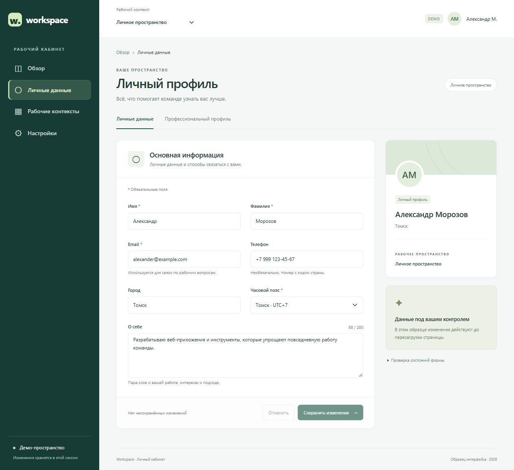

# Dashboard Profile

Самостоятельный frontend-образец рабочего кабинета на Vite, TypeScript и Bootstrap 5. Основной экран — личный профиль с формой; общий shell содержит навигацию, хлебные крошки и переключение рабочего контекста.

## Запуск

```powershell
git clone https://github.com/pepelaz1/dashboard-profile.git
cd dashboard-profile
npm ci
npm run dev
```

Node 22.9+ для выбранной линии Vite 6. Открыть http://127.0.0.1:5173/dashboard/profile.

- `npm run build` — проверка TypeScript и production-сборка.
- `npm test` — тесты модели профиля и registry.
- `npm run preview` — локальный просмотр production-сборки.

## Архитектура

- `src/routes.ts` — единый registry шести маршрутов, активное меню и хлебные крошки.
- `src/main.ts` — общий shell, History API, страницы и lifecycle формы.
- `src/profile.ts` — типы, нормализация, валидация и адаптер демо-сохранения.
- `src/html.ts` — экранирование пользовательского текста и поиск обязательных DOM-элементов.
- `src/style.css` — оформление поверх Bootstrap.
- `tests/profile.test.ts` — проверки валидации, сохранения, registry и экранирования.

Подробное объяснение навигации и решений: [ROUTING.md](ROUTING.md).

## Поведение

Sidebar доступен на desktop; на ширине менее 992 px используется Bootstrap Offcanvas. Escape, крестик и backdrop закрывают меню. При отмене меню фокус возвращается на кнопку; при выборе маршрута меню закрывается и фокус переводится на заголовок страницы.

Меню, крошки и выбор страницы используют общий registry. `/dashboard` и `/dashboard/overview` показывают один обзор без redirect. Поддерживаются переходы по истории браузера и обычное поведение ссылок с Ctrl/Cmd-click.

Форма поддерживает обязательные поля, сообщения об ошибках, сводку с управлением фокусом, busy state, успешное сохранение и повтор после ошибки. Успех обновляет карточку и topbar; отмена восстанавливает последнее сохранённое значение. Черновик сохраняется при переходах внутри SPA. Все данные находятся в памяти и сбрасываются при перезагрузке.

Раздел «Проверка состояний формы» позволяет включить искусственную ошибку следующего сохранения.

## Объём образца

Профиль и обзор реализованы как демо-страницы. Рабочие контексты переключают три демонстрационных пространства. Профессиональный подпрофиль и настройки представлены информационными заглушками.

Поля, дизайн и демо-данные выбраны для этого самостоятельного образца. Backend/API, реальный RBAC и постоянное хранилище не реализованы. Для production-размещения требуется SPA fallback на сервере; приложение должно использовать существующую инфраструктуру целевого проекта при интеграции.

Полный пакет внешнего ТЗ, reference-макеты и точные параметры QA108 не предоставлены. Соответствие QA108 не заявляется. Результаты собственных проверок записаны в [QA.md](QA.md).

## Документация зависимостей

- Bootstrap Offcanvas: https://getbootstrap.com/docs/5.3/components/offcanvas/
- Bootstrap validation: https://getbootstrap.com/docs/5.3/forms/validation/
- Vite: https://vite.dev/guide/

<!-- portfolio-visual:start -->
## Скриншот



Скриншот интерфейса.
<!-- portfolio-visual:end -->
